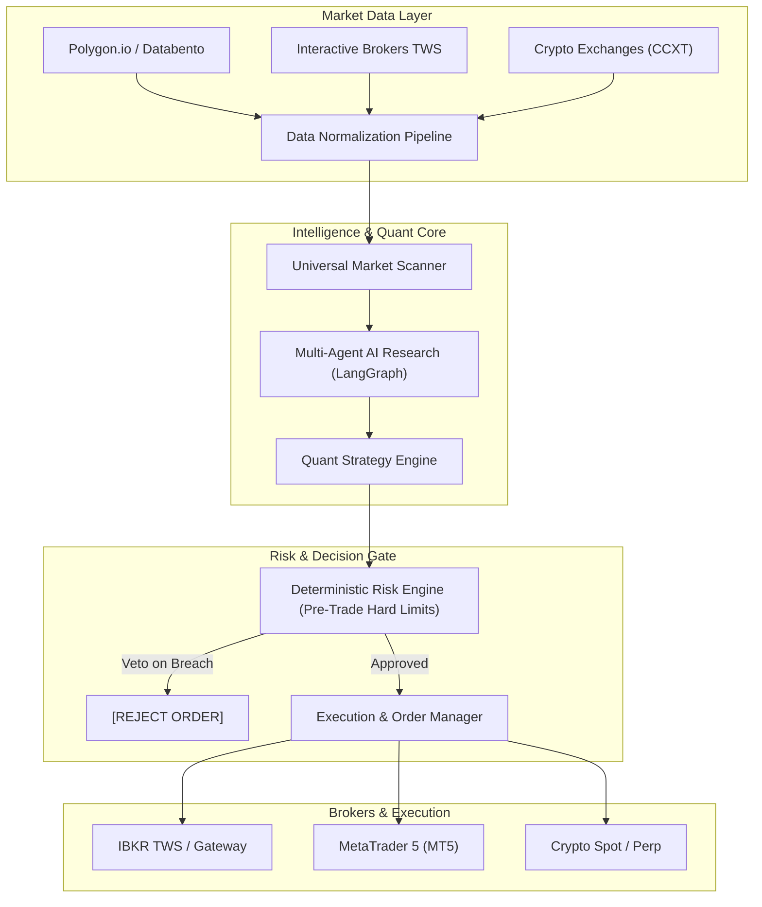

# 🌐 OpenTradeAI — The Open-Source AI Quantitative Trading Platform

> An open-source, multi-asset, multi-broker quantitative trading ecosystem. Unites real-time market scanners, multi-agent AI research, institutional risk validation, event-driven backtesting, and automated execution across **US Equities, Options, Futures, Crypto, and Forex**.

---

### 💼 Need Custom Quantitative Systems, Trading Bots, or Custom Integrations?
I engineer high-performance trading software, broker API integrations, and machine learning models for hedge funds, prop traders, and private syndicates.
* 💬 **Telegram:** [@JanzebBlockdev](https://t.me/JanzebBlockdev)
* 💼 **Fiverr Profile:** [Verified Quantitative Developer (Fiverr)](https://tinyurl.com/2wruxnsx)
* 📧 **Email:** `jahanzaibchanna70@gmail.com`

---

## 🏛️ System Architecture

## 📑 Core Modules
* **`apps/`**: Dashboard (Next.js/React), API Server (FastAPI), Desktop Terminal, CLI.
* **`packages/core/`**: Normalized instrument schemas, event bus, clock, and configuration.
* **`packages/market-data/`**: Streaming tick aggregators and historical parquet storage.
* **`packages/brokers/`**: Modular adapters for IBKR, MT5, and Crypto exchanges.
* **`packages/ai/`**: Multi-agent consensus (Bullish, Bearish, Sentiment, Options, Risk).
* **`packages/risk/`**: Pre-trade limits, position sizing, correlation matrix, emergency kill switch.
* **`packages/execution/`**: Smart order routing, bracket orders, fill reconciliation.
* **`mcp/`**: Model Context Protocol server exposing guarded trading tools to Claude/ChatGPT.

---
*Maintained by **Jahanzaib** ([@jahanzaib-codes](https://github.com/jahanzaib-codes))*
