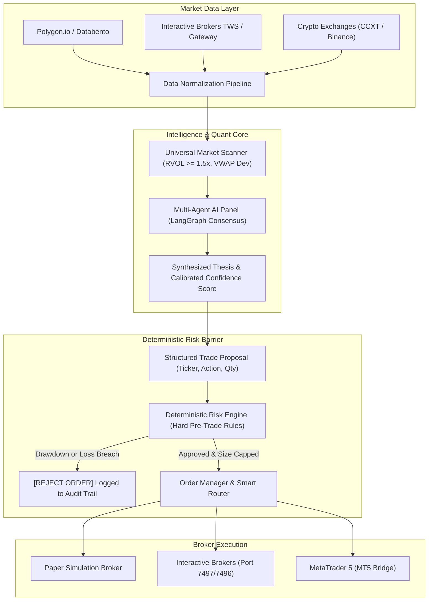

# 🌐 OpenTradeAI — The Open-Source AI Quantitative Trading Platform

[](https://python.org)
[](https://fastapi.tiangolo.com)
[](https://langchain.com)
[](https://interactivebrokers.com)
[](https://docker.com)
[](https://opensource.org/licenses/MIT)

> An open-source, multi-asset, multi-broker quantitative trading ecosystem. Unites real-time market scanners, **multi-agent LLM consensus research (LangGraph)**, institutional **deterministic risk validation**, and automated execution across **US Equities, Options, Futures, Crypto, and Forex**.

```
┌────────────────────────────────────────────────────────────────────────────────┐
│  🌐 OpenTradeAI Terminal — Live Quantitative Execution Engine                  │
│  Status: ACTIVE | Engine: LangGraph AI | Risk Gate: DETERMINISTIC HARD LIMITS  │
├────────────────────────────────────────────────────────────────────────────────┤
│  🔍 Scanner: 5 High-RVOL Setups Identified (NVDA, TSLA, AAPL, SPY, SOL)       │
│  🤖 Multi-Agent Consensus: BULLISH (Confidence: 81.4% | Regime: TREND_EXPAND) │
│  🛡️  Risk Engine Gate: APPROVED (Drawdown: 0.0% | Max Size: $10,000 | Kill: OFF)│
│  ⚡ Broker Status: Paper Simulation Active ($100,000 Starting Cash)             │
└────────────────────────────────────────────────────────────────────────────────┘
```

---

### 💼 Need Custom Quantitative Systems, Trading Bots, or Custom Broker Integrations?
I engineer high-performance trading software, broker API integrations, and machine learning models for hedge funds, prop traders, and private syndicates.
* 💬 **Telegram:** [@JanzebBlockdev](https://t.me/JanzebBlockdev)
* 💼 **Fiverr Profile:** [Verified Quantitative Developer (Fiverr)](https://tinyurl.com/2wruxnsx)
* 📧 **Email:** `jahanzaibchanna70@gmail.com`

---

## 📑 Table of Contents
1. [Key Architectural Highlights](#-key-architectural-highlights)
2. [End-to-End System Pipeline](#-end-to-end-system-pipeline)
3. [Multi-Agent Consensus Matrix](#-multi-agent-consensus-matrix)
4. [Deterministic Risk Gate (Anti-Hallucination)](#-deterministic-risk-gate-anti-hallucination)
5. [REST API & WebSocket Documentation](#-rest-api--websocket-documentation)
6. [Supported Markets & Broker Connectors](#-supported-markets--broker-connectors)
7. [Installation & Quickstart](#-installation--quickstart)
8. [CLI Terminal Walkthrough](#-cli-terminal-walkthrough)
9. [Explore Connected Quantitative Projects](#-explore-connected-quantitative-projects)
10. [Disclaimer](#-disclaimer)

---

## 🚀 Key Architectural Highlights

* **Multi-Agent Research Engine:** Deploys specialized agents (Technical Analyst, Bullish Catalyst, Bearish Risk, Sentiment NLP) engaging in structured debates to reach calibrated confidence scores (0–100%).
* **Deterministic Risk Gate:** AI agents generate proposals, but **no trade executes without deterministic risk verification**. Pre-trade checks enforce hard portfolio drawdown limits, daily loss ceilings, and buying power constraints.
* **Universal Multi-Asset Scanner:** Evaluates thousands of instruments for Relative Volume surges ($\ge 1.5\times$), VWAP standard deviation bands, and momentum breakout triggers.
* **Zero-Latency Paper Broker:** Built-in paper trading engine with simulated slippage, commissions, and automated position ledger updates for strategy validation out-of-the-box.
* **Production-Grade Microservice Backend:** FastAPI REST server with asynchronous endpoints, full OpenAPI/Swagger documentation, and Docker Compose orchestration.

---

## 🏛️ End-to-End System Pipeline



---

## 🤖 Multi-Agent Consensus Matrix

Each agent operates autonomously with distinct domain objectives to eliminate confirmation bias:

| Agent | Focus Area | Inputs / Models | Weight | Stance Criteria |
| :--- | :--- | :--- | :---: | :--- |
| **Technical Analyst** | Momentum, Overbought/Sold | RSI, VWAP, EMA Stacks, ATR | 35% | Bullish if price > VWAP & RSI $\in [45, 68]$ |
| **Bullish Catalyst** | Upside Breakouts, RVOL | Relative Volume, Order Flow Depth | 25% | Bullish if RVOL $\ge 1.5\times$ & Resistance break |
| **Bearish Skeptic** | Downside Traps, Resistance | Liquidity Pools, Overhead Supply | 20% | Neutral/Bearish if daily extension $> 3\%$ |
| **Sentiment NLP** | News Flow, Narrative Velocity | Social Polarities, Financial Filings | 20% | Bullish if Polarity $> +0.30$ |

---

## 🛡️ Deterministic Risk Gate (Anti-Hallucination)

AI models are probabilistic; risk management must be strictly **deterministic**. The risk engine vetoes any order that violates preset parameters:

| Risk Parameter | Enforcement Limit | Action on Breach |
| :--- | :--- | :--- |
| **Emergency Kill Switch** | Global Binary Toggle | Immediate rejection of all outbound orders |
| **Max Portfolio Drawdown** | 5.0% from Peak Equity | Halts new positions until drawdown recovers |
| **Max Daily Loss** | \$1,000.00 USD Realized | Disables trading for the remainder of the session |
| **Single Trade Allocation** | 2.0% Account Risk | Clamps quantity down to maximum approved dollar size |
| **Max Open Positions** | 5 Concurrent Holdings | Rejects entries for new symbols |
| **Buying Power Guard** | $100\%$ Available Margin | Rejects orders exceeding live purchasing capacity |

---

## 📡 REST API & WebSocket Documentation

When launched with `python main.py --mode server`, FastAPI serves interactive Swagger docs at `http://localhost:8000/docs`:

### Core Endpoints:
* `GET /health` — Service health and emergency kill-switch status.
* `GET /api/v1/account` — Real-time net liquidation, buying power, and daily realized PnL.
* `GET /api/v1/positions` — Active open portfolio positions with average entry prices.
* `GET /api/v1/scan?min_rvol=1.5&min_change=0.5` — Scans universe for momentum candidates.
* `GET /api/v1/market-data/{symbol}` — Retrieves latest quotes and VWAP values.
* `POST /api/v1/agents/research?symbol=NVDA` — Dispatches multi-agent panel and returns consensus report.
* `POST /api/v1/orders/preview` — Simulates order through Risk Engine without execution.
* `POST /api/v1/orders/execute` — Submits order for execution strictly subject to risk validation.
* `POST /api/v1/risk/kill-switch` — Engages or disengages global emergency kill switch.

### Example: Run Multi-Agent Research via cURL
```bash
curl -X POST "http://localhost:8000/api/v1/agents/research?symbol=NVDA"
```

---

## 🌐 Supported Markets & Broker Connectors

| Asset Class | Primary Broker / Feed | Key Capabilities |
| :--- | :--- | :--- |
| **US Equities & ETFs** | Interactive Brokers (TWS / Gateway) | Gap scanners, VWAP breakouts, limit/stop orders |
| **Options & 0DTE** | IBKR API & Cboe Feeds | Greeks (Delta, Gamma, Vega), IV skew, SPX 0DTE |
| **Futures** | CME via IBKR / Tradovate | ES, NQ, CL, GC front-month rollovers, VWAP |
| **Crypto & Meme Coins** | Binance, Bybit, Solana WebSockets | Raydium/Pump.fun tracking, smart money wallets |
| **Forex** | MetaTrader 5 (MT5 Bridge) | Institutional prop firm risk limits, session breakouts |

---

## 🛠️ Installation & Quickstart

### Method 1: Local Python Environment
```bash
# 1. Clone repository
git clone https://github.com/jahanzaib-codes/OpenTradeAI.git
cd OpenTradeAI

# 2. Create and activate virtual environment
python -m venv .venv
source .venv/bin/activate  # On Windows: .venv\Scripts\activate

# 3. Install dependencies
pip install -r requirements.txt

# 4. Copy environment configuration
cp .env.example .env

# 5. Run automated end-to-end demo pipeline
python main.py --mode demo
```

### Method 2: Docker Compose (1-Command Launch)
```bash
docker-compose up --build
```

---

## 💻 CLI Terminal Walkthrough

Launch the interactive command-line trading suite:

```bash
python main.py --mode cli
```

```
[MAIN MENU]
1. 🔍 Run Universal Market Scanner
2. 🤖 Run Multi-Agent AI Research on Ticker
3. 🛡️  Simulate Deterministic Risk Engine Check
4. ⚡ Execute Paper Trade Order
5. 📊 View Portfolio Positions & Account Summary
6. 🚨 Toggle Emergency Kill Switch
7. ❌ Exit Terminal
```

---

## ⭐ Explore Connected Quantitative Projects

* 🎯 **[IBKR Options Intelligence & 0DTE Suite](https://github.com/jahanzaib-codes/IBKR-Options-Intelligence)** — Institutional SPX 0DTE analytics, GEX profiling, and multi-leg spread execution.
* 📈 **[IBKR AI Options Trading Bot & GUI](https://github.com/jahanzaib-codes/ibkr-ai-trading-bot-gui)** — Desktop options terminal with trained XGBoost classifier and backtesting suite.
* ⚡ **[Solana Pump.fun 0-Block Sniper Bot](https://github.com/jahanzaib-codes/solana-pumpfun-sniper-bot)** — Ultra low-latency meme coin sniper powered by Rust and Jito MEV bundles.
* 🛡️ **[PropFirm MT5 Risk Guardian EA](https://github.com/jahanzaib-codes/propfirm-mt5-risk-guardian)** — Institutional MQL5 risk manager enforcing daily and total drawdown limits for FTMO / FundedNext.
* 🔮 **[Polymarket Prediction Arbitrage Bot](https://github.com/jahanzaib-codes/polymarket-prediction-arbitrage-bot)** — Real-time binary market arbitrage engine exploiting price discrepancies across predictive books.

---

## ⚠️ Disclaimer

*OpenTradeAI is an open-source software platform designed for quantitative research, algorithmic strategy development, and educational purposes. Trading financial markets involves substantial risk of capital loss. Always validate strategies extensively in paper trading mode before committing live capital.*

---
*Maintained by **Jahanzaib** ([@jahanzaib-codes](https://github.com/jahanzaib-codes))*
